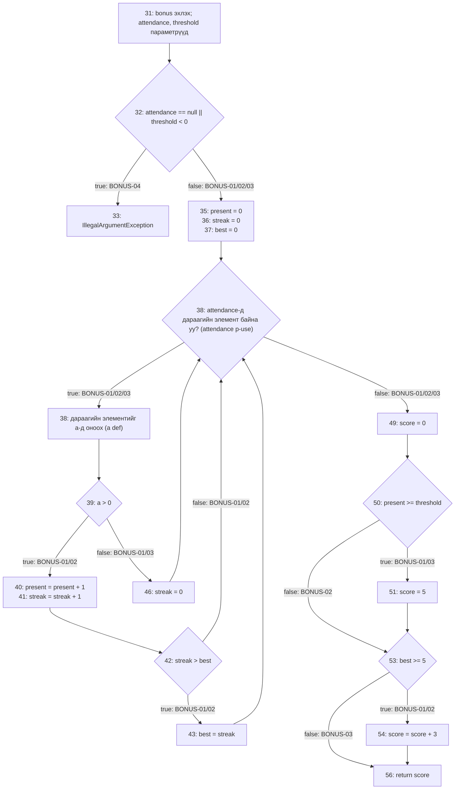

# Лаборатори 10: Өгөгдлийн урсгалын анализ

Энэ лабораторид `gcd` болон `bonus` функцийн тодорхойлолт (definition, **def**) ба хэрэглээ (use)-ний цэгүүдийг мөрийн дугаараар нь шинжилж, def-clear замтай DU хосуудыг тэмдэглэв. JaCoCo-ийн branch хэмжүүр нь DU-хосын хамралт биш гэдгийг үр дүнтэй харьцуулна.

> **Кодын мөрийн дугаар:** Доорх бүх дугаар нь [`DataFlowTargets.java`](src/main/java/mn/edu/must/sqat/DataFlowTargets.java) файлын дугаар. Үйлдвэрлэлийн кодыг тайлан бэлтгэхдээ өөрчлөөгүй.

## Орчин ба файлууд

Төслийн Maven тохиргоо Java 17 target-тай; энэ ажлыг Windows 11 дээр Java 22, Maven 3.10.0 ашиглан ажиллуулав. Командын гаралт:

```text
> java -version
java version "22.0.2" 2024-07-16
Java(TM) SE Runtime Environment (build 22.0.2+9-70)
Java HotSpot(TM) 64-Bit Server VM (build 22.0.2+9-70, mixed mode, sharing)

> mvn -version
Apache Maven 3.10.0 (c43a36b8d67be7e0805a411bc0898af1a51f5472)
Maven home: C:\Tools\apache-maven-3.10.0
Java version: 22.0.2, vendor: Oracle Corporation, runtime: C:\Program Files\Java\jdk-22
Default locale: en_US, platform encoding: UTF-8
OS name: "windows 11", version: "10.0", arch: "amd64", family: "windows"
```

JUnit 5 тестүүд `src/test/java/mn/edu/must/sqat/` дотор байна. `mvn verify`-ийн өмнөх хадгалсан үр дүн [`results/mvn-verify-alldefs.txt`](results/mvn-verify-alldefs.txt), JaCoCo CSV нь [`results/jacoco-alldefs.csv`](results/jacoco-alldefs.csv).

Оюутны нэр, кодыг энэ ажлын орчинд өгөөгүй тул README-д хувийн мэдээлэл зохиож оруулаагүй. AI туслахыг тест болон энэ тайлангийн ноорог бэлтгэх, DU замын анализыг нягтлахад ашигласан.

## A. `gcd` функцийн DU анализ

Мөрийн зураглал: 13-р мөрд `x`, `y` параметрийн def; 15-р мөрд `y`-ийн p-use; 16-р мөрд `x`, `y`-ийн c-use ба `tmp`-ийн def; 17-р мөрд `y`-ийн c-use ба `x`-ийн def; 18-р мөрд `tmp`-ийн c-use ба `y`-ийн def; 20-р мөрд `x`-ийн c-use байна.

### Бүх def-clear DU хос

| Хувьсагч | Def мөр | Use мөр | Use төрөл / салаа | Def-clear замын тойм | Тест | Хамрагдсан |
|---|---:|---:|---|---|---|---|
| `x` | 13 | 16 | c-use | 13 → 15(T) → 16 | GCD-02, GCD-03 | Тийм |
| `x` | 13 | 20 | c-use | 13 → 15(F) → 20 | GCD-01 | Тийм |
| `x` | 17 | 16 | c-use | 17 → 18 → 15(T) → 16 | GCD-02 | Тийм |
| `x` | 17 | 20 | c-use | 17 → 18 → 15(F) → 20 | GCD-02, GCD-03 | Тийм |
| `y` | 13 | 15 | p-use, T | 13 → 15(T) | GCD-02, GCD-03 | Тийм |
| `y` | 13 | 15 | p-use, F | 13 → 15(F) | GCD-01 | Тийм |
| `y` | 13 | 16 | c-use | 13 → 15(T) → 16 | GCD-02, GCD-03 | Тийм |
| `y` | 18 | 15 | p-use, T | 18 → 15(T) | GCD-02 | Тийм |
| `y` | 18 | 15 | p-use, F | 18 → 15(F) | GCD-02, GCD-03 | Тийм |
| `y` | 18 | 16 | c-use | 18 → 15(T) → 16 | GCD-02 | Тийм |
| `tmp` | 16 | 18 | c-use | 16 → 17 → 18 | GCD-02, GCD-03 | Тийм |

Тестийн ID нь [`GcdTest.java`](src/test/java/mn/edu/must/sqat/GcdTest.java)-ийн `@DisplayName`-тай таарна.

- **GCD-01 — `gcd(7, 0) = 7`:** давталтын нөхцөл эхний удаа худал тул x@13→20 болон y@13→15(F) хосыг ганцаараа хамарна.
- **GCD-02 — `gcd(12, 8) = 4`:** хоёр удаа давталтын биеийг ажиллуулна. x@13→16, y@13→16, x@17→16, y@18→16, tmp@16→18 болон y-ийн нөхцөлийн T/F салаануудыг хамарна.
- **GCD-03 — `gcd(0, 5) = 5`:** нэг удаа давталтын биеийг ажиллуулаад гарна; эхний параметр 0 байх үеийн замыг батална.

## B. `bonus` функцийн анализ

### B1. CFG-ийн бүтэц

Доорх Mermaid зураг нь мөрийн дугаартай гол зангилаа, салаа болон давталтыг харуулна. Гэхдээ энэ репод одоогоор шаардлагатай `cfg-bonus.png` экспортолсон зураг **байхгүй**.



Тестийн нэрс: BONUS-01 `bonusAllDefsAndThresholdBranch`; BONUS-02 `bonusStreakWinsWithoutThreshold`; BONUS-03 `bonusResetsStreakAndHandlesEmptyOrZeroCases`; BONUS-04 `bonusRejectsInvalidInput`. BONUS-04 нь нэг тестийн метод дотор хоёр invalid оролтыг шалгана. CFG-ийн for-each алхам нь дараагийн элементийг `a`-д оноох def, нөхцөл нь дараагийн элемент байгаа эсэх p-use гэж загварчлагдсан.

### B2. Def/use жагсаалт

| Мөр | Def | Use |
|---:|---|---|
| 31 | `attendance`, `threshold` параметрүүд | — |
| 32 | — | `attendance == null` p-use; `threshold < 0` p-use (эхний нөхцөл худал үед шалгана) |
| 33 | — | Алдаа мессежийн тогтмол утга; DU хувьсагчийн use биш |
| 35 | `present = 0` | — |
| 36 | `streak = 0` | — |
| 37 | `best = 0` | — |
| 38 | `a` (итераторын def) | `attendance`-д дараагийн элемент байгаа эсэх p-use |
| 39 | — | `a > 0` p-use |
| 40 | `present` | `present + 1` c-use |
| 41 | `streak` | `streak + 1` c-use |
| 42 | — | `streak > best` p-use; `streak`, `best` |
| 43 | `best` | `streak` c-use |
| 46 | `streak = 0` | — |
| 49 | `score = 0` | — |
| 50 | — | `present >= threshold` p-use; `present` c-use, `threshold` c-use |
| 51 | `score = 5` | — |
| 53 | — | `best >= 5` p-use; `best` c-use |
| 54 | `score` | `score + 3` c-use |
| 56 | — | `score` c-use |

### B3. DU хүснэгт ба all-DU-pairs-ийн бодит хамралт

Хүснэгтэд тухайн def-ээс use хүртэл дахин def хийгдээгүй замыг тэмдэглэв. `+` нь одоогийн тестээр хамрагдсан, `—` нь одоогийн тестүүдээр хамрагдаагүй, `боломжгүй` нь уг def use хүртэл хүрэхийн өмнө заавал kill болох эсвэл нөхцөл биелэх боломжгүйг илтгэнэ.

| Хувьсагч | Def | Use | Төрөл / салаа | Замын нөхцөл | Тест | Төлөв |
|---|---:|---:|---|---|---|---|
| `attendance` | 31 | 32 | p-use, null=true | null аргумент | BONUS-04 | + |
| `attendance` | 31 | 32 | p-use, null=false | null биш аргумент | BONUS-01/02/03 | + |
| `attendance` | 31 | 38 | p-use, элемент байна | хүчинтэй массивын iteration | BONUS-01/02/03 | + |
| `attendance` | 31 | 38 | p-use, дууссан | массивын төгсгөлд хүрэх | BONUS-01/02/03 | + |
| `threshold` | 31 | 32 | p-use, сөрөг=true | attendance null биш, threshold < 0 | BONUS-04 | + |
| `threshold` | 31 | 32 | p-use, сөрөг=false | attendance null биш, threshold >= 0 | BONUS-01/02/03 | + |
| `threshold` | 31 | 50 | c-use | хүчинтэй оролтын дараа | BONUS-01/02/03 | + |
| `a` | 38 | 39 | p-use, >0=true | эерэг элемент | BONUS-01/02 | + |
| `a` | 38 | 39 | p-use, >0=false | 0 элемент | BONUS-01/03 | + |
| `a` | 38 | 40 | c-use | эерэг элемент | BONUS-01/02 | + |
| `a` | 38 | 41 | c-use | эерэг элемент | BONUS-01/02 | + |
| `present` | 35 | 40 | c-use | эхний эерэг өдөр | BONUS-01/02 | + |
| `present` | 35 | 50 | p-use, true | бүх өдөр тоологдсоны дараа threshold биелнэ | BONUS-01/03 | + |
| `present` | 35 | 50 | p-use, false | эерэг өдрийн тоо threshold-ээс бага | BONUS-02 | + |
| `present` | 40 | 40 | c-use | дараагийн эерэг өдөр; давталт дахь use | BONUS-01/02 | + |
| `present` | 40 | 50 | p-use, true | эерэг өдрийн тоо threshold хүрнэ | BONUS-01 | + |
| `present` | 40 | 50 | p-use, false | эерэг өдрийн тоо threshold хүрэхгүй | BONUS-02 | + |
| `streak` | 36 | 41 | c-use | эхний элемент эерэг байх | BONUS-01/02 | + |
| `streak` | 41 | 41 | c-use | өмнөх элемент эерэг, дараагийнх эерэг | BONUS-01/02 | + |
| `streak` | 41 | 42 | p-use, true | одоогийн streak best-ээс урт | BONUS-01/02 | + |
| `streak` | 41 | 42 | p-use, false | өмнөх streak reset хийгдэж, best хадгалагдсан | BONUS-01 | + |
| `streak` | 46 | 41 | c-use | тасалдлын дараа дараагийн элемент эерэг | BONUS-01 | + |
| `best` | 37 | 42 | p-use, true | анхны best=0; streak эерэг болоход нөхцөл true | BONUS-01/02 | + |
| `best` | 37 | 42 | p-use, false | 0-ээс эхэлсэн best-ийг шинэчлэлгүйгээр false хүрэх | — | Боломжгүй |
| `best` | 37 | 53 | p-use, false | best=0 хэвээр (эерэг streak байхгүй) | BONUS-03 | + |
| `best` | 37 | 53 | p-use, true | best=0-ийг шинэчлэлгүйгээр 5 хүрэх | — | Боломжгүй |
| `best` | 43 | 42 | p-use, true | дараагийн урт эерэг цуваанд дээд амжилт ахина | BONUS-01 | + |
| `best` | 43 | 42 | p-use, false | дараагийн streak best-ээс бага/тэнцүү | BONUS-01 | + |
| `best` | 43 | 53 | p-use, true | хамгийн урт streak 5 буюу түүнээс урт | BONUS-01/02 | + |
| `best` | 43 | 53 | p-use, false | best шинэчлэгдсэн ч эцсийн streak 5 хүрэхгүй | — | — |
| `score` | 49 | 54 | c-use | threshold худал, best>=5 | BONUS-02 | + |
| `score` | 49 | 56 | c-use | threshold худал, best<5 | — | — |
| `score` | 51 | 54 | c-use | threshold үнэн, best>=5 | BONUS-01 | + |
| `score` | 51 | 56 | c-use | threshold үнэн, best<5 | BONUS-03 | + |
| `score` | 54 | 56 | c-use | нэмэлт оноо тооцсоны дараа буцаах | BONUS-01/02 | + |

`streak = 0` (46-р мөр) нь өмнө байсан `streak` def-үүдийг kill хийнэ: 41-р мөрийн def нь сөрөг салаа руу орсон тухайн iteration-ээс хойших use-д хүрэхгүй; 36-р мөрийн def нь 46-р мөрөөр таслагдаж болно. Харин 46-р мөрийн шинэ def дараагийн элементийн 41-р мөрийн баруун талын c-use-д хүрч болох тул түүнийг үхсэн def гэж шууд тооцохгүй. `best@37 -> 42(false)` боломжгүй: уг def use-д хүрсэн эхний эерэг элементэд streak дор хаяж 1 тул `streak > 0` үнэн болж, 43-р мөр best-ийг kill хийнэ. `best@37 -> 53(true)` ч боломжгүй: best 0-ээс 5 болохын тулд 43-р мөрийн def заавал үүсэх ёстой.

Одоогийн тестүүдэд бүх def-ээс дор хаяж нэг use-д хүрэх жишээ бий. All-defs-ийн хамгийн багадаа **хоёр** хүчинтэй гүйцэтгэл шаардагдана: `score@49`-ийг use-д хүргэхийн тулд `present >= threshold` худал байх ёстой; харин `score@51` def үүсэхийн тулд энэ нөхцөл үнэн байх ёстой. Эдгээр нь нэг гүйцэтгэлд зэрэг биелэхгүй. BONUS-01 ба BONUS-02 энэ хоёр шаардлагыг тус тус хангана; BONUS-03 нэмэлт reset/false салааг шалгана. Харин одоогийн багц бүх DU хосыг хамраагүй: хүснэгтийн `score@49 -> 56`, `best@43 -> 53(false)` мөрүүд хамрагдаагүй бөгөөд all-defs хангагдсан эсэх нь all-DU-pairs хангагдсан гэсэн үг биш.

## B5. JaCoCo үр дүн

[`results/jacoco-alldefs.csv`](results/jacoco-alldefs.csv)-ийн `DataFlowTargets` мөр:

| Үзүүлэлт | Утга |
|---|---:|
| Branch missed / covered | 0 / 16 (16/16, 100%) |
| Line missed / covered | 1 / 23 (23/24) |
| Instruction missed / covered | 3 / 78 |

Нэг missed line нь классийн далд default constructor. Үүнийг хамруулахын тулд `new DataFlowTargets()` тест нэмэх эсвэл эх кодыг өөрчлөх шаардлагагүй. Одоогийн 7 JUnit тест бүгд амжилттай (`BonusTest`: 4, `GcdTest`: 3). Branch 100% болсон ч DU хүснэгтэд хамрагдаагүй def-use хос үлдэж болно; жишээ нь `score@49 -> 56` болон `best@43 -> 53(false)`. JaCoCo branch хэмжүүр нь тухайн def яг аль use-д kill-гүйгээр хүрснийг хэмждэггүй.

Одоогоор [`results/jacoco-final.csv`](results/jacoco-final.csv) тусдаа файл үүсээгүй; `jacoco-alldefs.csv` нь одоогийн тестийн багцын тайлан юм.

## C. Fault seeding — төлөв

Доорх мутацийн туршилтууд одоогоор гүйцэтгэгдээгүй. Иймээс үр дүнг зохиомлоор бичээгүй бөгөөд заасан `results/` лог файлууд байхгүй.

| Мутаци | Өөрчлөлт | Туршилтын үр дүн |
|---|---|---|
| M1 | 41-р мөрийн `streak = streak + 1`-ийг устгах | Гүйцэтгээгүй; `results/mvn-test-M1.txt` байхгүй |
| M2 | 43-р мөрийн `best = streak`-ийг `best = present` болгох | Гүйцэтгээгүй; `results/mvn-test-M2.txt` байхгүй |
| M3 | Давталтын дараа ашиглагдахгүй `total = present + best` def нэмэх | Гүйцэтгээгүй; `results/mvn-test-M3.txt` байхгүй |

Эх код дээр мутаци хийж, тестийн үр дүн болон IDE-ийн M3 анхааруулгыг бүртгэсний дараа энэ хүснэгтийг бодит логийн мэдээллээр шинэчлэх шаардлагатай. Тайлан илгээх үед эх код цэвэр, өөрчлөлтгүй байх ёстой.

## Дүгнэлт

DU анализ нь тестээр зөвхөн салааг дагуулсан эсэхээс гадна тодорхой def ямар use-д kill-гүй хүрснийг шалгадаг. Иймээс branch 100% болсон ч зарим def-use хос огт хамрагдаагүй байж болно. Энэ жишээнд `score@49 -> 56` хос branch хамралтаас харагдахгүй. DU хүснэгт гаргах нь JaCoCo тайлан уншихаас илүү гар ажиллагаатай бөгөөд хувьсагчийн дахин тодорхойлолт бүрийг дагах шаардлагатай. Loop болон reset замууд энэ ажлыг илүү төвөгтэй болгодог. Одоогийн тестүүд all-defs-д шаардлагатай хоёр үндсэн `score` замыг тус тус хамарч, нэмэлт reset тесттэй. All-DU-pairs-ийн хүснэгтэд хамрагдаагүй хос байгааг ил тод тэмдэглэсэн. Fault-seeding-ийн бодит үр дүн болон `cfg-bonus.png`-ийг нэмэх хүртэл тайлан лабораторийн бүх шаардлагыг бүрэн хангаагүй хэвээр байна.

## Туршилт ажиллуулах

```powershell
mvn verify
```

JaCoCo HTML тайлан `target/site/jacoco/index.html`-д үүснэ. `target/` нь `.gitignore`-д байгаа тул GitHub-д нэмэгдэхгүй.
